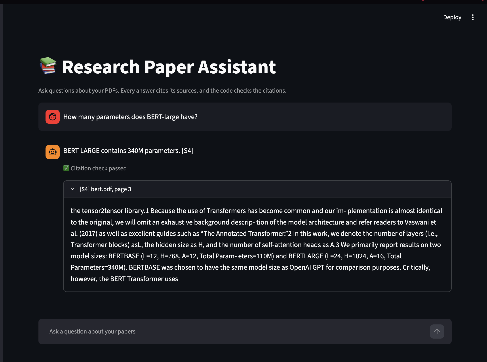

# Research Paper Assistant

A question-answering app over research-paper PDFs. It retrieves relevant passages with hybrid search and re-ranking, writes answers with a local LLM, and cites its sources. A script then checks the citations. Everything runs locally and needs no API keys.



## Features

- **Hybrid retrieval**: vector search (by meaning) and BM25 keyword search, merged with Reciprocal Rank Fusion
- **Cross-encoder re-ranking** of the merged candidates
- **Query rewriting** for follow-up questions such as "And BERT-base?"
- **Source labels with checked citations**: the model cites `[S1]`, `[S2]`, and the code maps each label to a document and page, then checks that the cited sources exist and that numbers in the answer appear in the cited text
- **Evaluation script** that compares the four search methods using Hit Rate@5 and MRR
- **Streamlit app** with a search-method selector, a per-paper filter, and expandable source text

## How it works

```
PDFs -> pages -> chunks (800 chars, 150 overlap) -> embeddings in ChromaDB + chunks.json

Question
  -> (follow-up? rewrite it using the chat history)
  -> vector search + keyword search -> merge (RRF)
  -> cross-encoder re-rank -> top 5 chunks
  -> LLM answers using only those chunks, citing [S1]...[S5]
  -> citation check
```

## Evaluation

16 questions over two papers (`bert.pdf` and `dense.pdf`): 8 use the papers' own wording and 8 are paraphrases. A search counts as a hit if a correct page appears in the top 5 results.

| Method | Hit Rate@5 | MRR |
|---|---|---|
| Vector | 0.88 | 0.78 |
| Keyword (BM25) | 0.81 | 0.57 |
| Hybrid | 0.88 | 0.69 |
| Hybrid + re-rank | **0.94** | 0.78 |

Hybrid search with re-ranking found a correct page for 15 of 16 questions, versus 14 for vector search and 13 for keyword search. Every miss came from the paraphrased questions, and keyword search degraded most on them. One paraphrased question was missed by all four methods.

## Limitations

- **Small evaluation.** 16 questions, covering 2 of the 4 papers, written with AI assistance and checked against the PDF pages. The gap between methods is one question, so the results are indicative and not conclusive.
- **The citation check is partial.** It verifies that cited sources exist and that numbers in the answer appear in the cited text. It does not verify that every sentence is supported by the sources.
- **Small local model.** It runs `llama3.2` through Ollama, which is weaker than hosted models, so some answers will be incomplete or wrong.
- **Text-only PDFs.** Scanned PDFs, tables and figures are not handled.

## Setup

Developed on macOS with Python 3.13.

1. Install [Ollama](https://ollama.com), open it, and download the model:
```
   ollama pull llama3.2
```
2. Create an environment and install the packages:
```
   python -m venv venv
   source venv/bin/activate
   pip install -r requirements.txt
```
3. Put text-based PDFs in the `docs/` folder. The papers used here were *Attention Is All You Need*, *BERT*, *Dense Passage Retrieval for Open-Domain Question Answering* and *Retrieval-Augmented Generation for Knowledge-Intensive NLP Tasks*, saved as `attention.pdf`, `bert.pdf`, `dense.pdf` and `nlp.pdf`.
4. Build the index:
```
   python -m src.ingest
```

## Usage

```
python -m streamlit run app.py     # web app at localhost:8501
python -m src.answer               # chat in the terminal
python -m src.retrieval            # compare the four search methods on one question
python -m eval.run_eval            # run the evaluation
```

The evaluation questions are in `eval/questions.json`. If you use different PDFs, replace them with questions and page numbers for your own documents.

## Project structure

```
app.py              Streamlit app
src/config.py       settings (paths, model names, chunk size)
src/ingest.py       PDFs -> chunks -> database
src/retrieval.py    vector, keyword, hybrid and re-ranked search
src/answer.py       query rewriting, answer generation, citation check
eval/run_eval.py    Hit Rate@5 and MRR for each search method
eval/questions.json evaluation questions with correct pages
```

## What I would add next

- A larger evaluation set covering all papers, with questions that have no answer in the documents
- A check that each sentence of an answer is supported by its cited source
- Table and figure extraction from PDFs